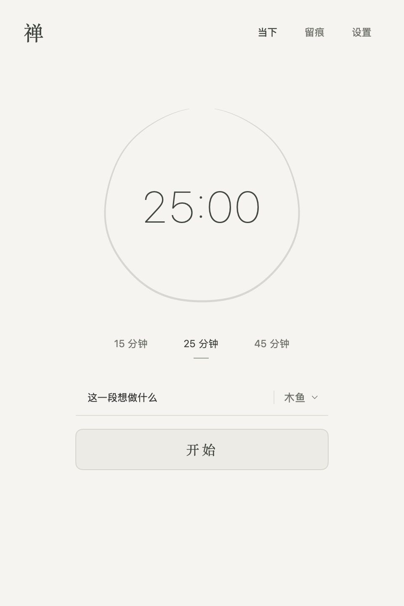

# 禅 · Zen

[](https://github.com/jaylinwang/zen/actions/workflows/ci.yml)
[](https://github.com/jaylinwang/zen/releases/latest)
[](LICENSE)

A native, local-first focus timer for macOS and iPhone, built with SwiftUI. No account, server, analytics, or third-party Swift dependencies.

开源、离线的原生专注计时工具。Mac 与 iPhone 共用计时和记录格式；本地文件由你自行同步。

开始一段时间 → 完成专注 → 留下一句话。主动放弃直接结束，不留记录。没有暂停续接、账号、服务端和注意力监控。

## 下载与安装

从 [GitHub Releases](https://github.com/jaylinwang/zen/releases/latest) 下载最新 DMG。macOS 13+，通用安装包支持 Apple Silicon 与 Intel。打开 DMG，将「禅」拖到 Applications，首次运行后在设置中选择记录文件夹。iPhone 暂提供源码构建。

首版使用 ad-hoc 临时签名，**尚未经过 Apple Developer ID 签名和公证**。确认来源后，可按 [Apple 官方说明](https://support.apple.com/zh-cn/102445) 在系统「隐私与安全性」中允许打开。Release 同时提供 SHA-256 校验文件。



## 当前实现

- Mac 菜单栏与主窗口，iPhone 触控界面；共享 SwiftUI 与 Swift 核心。
- 可自定专注 / 休息时长；不选名称也能开始，支持最近名称。
- 陪伴声音：静音、木鱼、松风、细雨（有声选项均为内置真实录音，循环播放）；音量、木鱼间隔及试听，木鱼默认每 2 秒一声。结束时独立音量敲磬，Mac 自动弹出本轮补记，输入一句按 Enter 保存。
- 主动放弃不记录时间；到时结束生成独立的待补记，输入自动保存在本机草稿。
- 中文补记、备注、资料路径 / URL、空白保存、稍后补记。
- 每条记录一个可读 Markdown 文件；刷新外部文件、同 ID 去重、冲突提示、写入前内容检查。
- 连续时间基准包含系统睡眠，完成时长不随延迟回调增长。
- Mac 全局开始 / 放弃快捷键、系统通知、登录启动设置。
- Mac 异常退出保留检查点；iPhone 在同一次系统启动内可恢复后台计时。

已使用 Xcode 26.3 完成 iPhone 模拟器与真机架构编译。Mac 已通过核心与应用流程检查；iPhone 的模拟器操作和真机行为需分别验收。完整验收状态见 [docs/IMPLEMENTATION.md](docs/IMPLEMENTATION.md)。

## 构建 Mac

需要 macOS 13+ 和 Swift 5.9+。没有第三方依赖。

```sh
./scripts/build-mac.sh
open build/禅.app
```

产物是本机临时签名的自用应用，不是公证发行包。可复制到 Applications 后再设置登录启动。首次进入设置选择数据文件夹，按需点击“允许通知”。

快捷键默认：Control + Option + Space 开始，Control + Option + Escape 放弃。可在设置中更换组合；冲突会提示。

## Xcode / iPhone

打开 `Zen.xcodeproj`，选择 `Zen-iOS` scheme。选择模拟器即可构建；在自己的 iPhone 上运行时需在 Signing & Capabilities 中选择自己的开发团队，并使用唯一的 Bundle Identifier。项目不使用 CloudKit，也不要求云服务账号。手机数据目录通过系统文件选择器授权，具体文件提供程序的行为需要真机验证。

`Zen-macOS` scheme 用于带沙箱的 Mac 构建；与命令行本机签名产物的沙箱及登录启动行为需分别验收。

两个原生 target 通过本地 Swift Package 引用 `ZenUI` 与 `ZenCore`。工程生成脚本为 `scripts/generate-project.py`，修改生成配置时同时修改该脚本。

## 检查

```sh
./scripts/check.sh
# 可选：原生 SwiftUI 页面渲染
./scripts/check.sh --render /tmp/zen-previews
```

检查程序不依赖 XCTest，适用于只有 Command Line Tools 的 Mac。它们使用独立临时目录，不读取你的专注记录。测试覆盖和未验证项见实现状态文档。

## 本地记录

```text
你选择的文件夹/
└── records/2026/10/2026-10-21/<会话 UUID>.md
```

文件是正式记录来源，包含起止时间、目标和实际时长、完成状态、内容与备注。App 设置和恢复草稿不在这个目录中。Mac 命令行构建的本机状态位于 `~/Library/Application Support/Zen/`；沙箱构建使用对应应用容器。

将 `records` 目录通过你自己的方式复制或同步到另一端，在“留痕”中刷新。文件到达不会开始计时或再次提醒。“已保存”只代表当前设备写入成功。

正文以 `### 内容` 和 `### 备注` 分区；正文行如果以 `#` 或 `\` 开头，文件里多加一个 `\`，读取时还原。`reference` 用 JSON 字符串表示，其他未知字段或版本会被保留并提示，App 不会强行改写。

不同会话各有文件；同一条记录请避免同时在两端修改。发现冲突时，保留文件和本机草稿，手动整理后刷新。App 无法拦截外部同步软件在它未读取前覆盖文件。

## 目录

- `Sources/ZenCore`：会话、Markdown、文件存储、恢复草稿。
- `Sources/ZenUI`：界面、应用状态、声音、提醒、快捷键。
- `Sources/ZenApp`：两端应用入口与 Mac 单实例保护。
- `Tests/ZenCoreTests`：可执行的文件 / 计时验证。
- `Verification`：可执行的应用流程与原生渲染验证。
- `docs/PRD.md`：产品需求。

木鱼录音来自 [jonopodmore 的 Mokugyo.wav](https://freesound.org/people/jonopodmore/sounds/607215/)，采用 CC0 授权。另含 s-light 的钵磬、schneidi67 的松林风声及 soundrecorder7 的细雨，均为 CC0 录音。磬声仅用于结束时单次提醒、陪伴声音循环，素材已内置，来源与处理说明见 `Sources/ZenUI/Resources/SOUND-CREDITS.txt`。

手机端检查：`./scripts/verify-ios.sh` 验证 SDK 编译与资源配置；`./scripts/check-ios-ui.sh` 在一次性模拟器中验证一分钟完整流程和实际文件。详见实现记录。

## 开源与贡献

代码和原创文档采用 [MIT](LICENSE) 许可证；内置第三方录音采用 CC0，来源和处理说明见 [SOUND-CREDITS.txt](Sources/ZenUI/Resources/SOUND-CREDITS.txt)，这些素材不改授 MIT。

欢迎提交 Issue 和 PR。请阅读 [贡献指南](CONTRIBUTING.md)、[行为准则](CODE_OF_CONDUCT.md) 与 [安全政策](SECURITY.md)。版本变化见 [更新日志](CHANGELOG.md)，自动打包与发布见 [发布指南](docs/RELEASING.md)。
